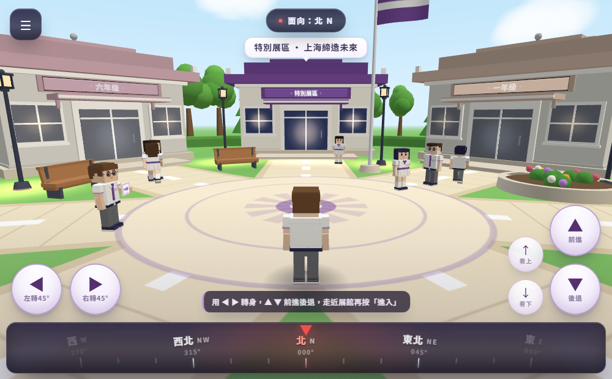
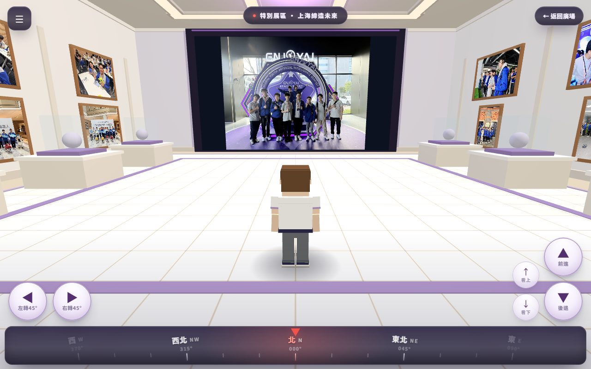

# STEAM DAY 虛擬校園 · Virtual Campus

各項活動的成果與花絮，放在一個可以走動的 3D 校園裡。
中央廣場 → 六道門 → 六個展館（相片牆 + 影片）。

- 純靜態網站，**沒有後端、沒有打包工具**，可以直接放 GitHub Pages
- Three.js r170 已放在 `vendor/`，離線也能跑
- 繁體中文 / English 雙語切換
- 男、女校服角色可切換
- 影片用 YouTube 或 Google Drive 嵌入（不佔 repo 體積）





---

## 一、本機開啟

雙擊 `start.bat`（需要 Node.js），或在這個資料夾執行：

```powershell
node serve.mjs
# 或
python -m http.server 8138
```

然後開 <http://127.0.0.1:8138>。

> 一定要用伺服器開，**不要直接雙擊 `index.html`**——
> `content.json` 用 `fetch()` 讀取，`file://` 會被瀏覽器擋住。

## 二、操作

| 動作 | 鍵盤 | 畫面按鈕 |
| --- | --- | --- |
| 前進 / 後退 | `W` `S` 或 `↑` `↓` | 右下 ▲ ▼ |
| 左轉 / 右轉 45° | `A` `D` 或 `←` `→` | 左下 ◀ ▶（可長按） |
| 擡頭 / 低頭 | `Q` `Z` 或 `PageUp` `PageDown` | 右下 ↑ ↓ |
| 進入展館 / 播放 | `E` 或 `Enter` | 畫面中央提示按鈕 |
| 放大相片 | 點相片牆或大螢幕 | 進入展館後直接點 |
| 回廣場 | `Esc` | 右上「返回廣場」 |
| 選單（跳展區、語言、角色、轉正面） | — | 左上 ☰ |

> 展館內視角較廣（FOV 66°），加上可擡頭低頭，站近大螢幕也看得到整張相。

### 相片放大

在展館內**點一下牆上的相片**（或大螢幕正在播的那張），就會全螢幕放大：

- 左右箭頭或 `←` `→` 換相片，標題會顯示「3 / 15」
- 點黑色背景、按 `Esc` 或右上 ✕ 關閉
- 放大期間角色不會走動
- 桌面版滑過相片時游標會變成放大鏡

## 二之一、iPad / 電腦

- 目標是 **iPad 橫向 + Safari**，也支援電腦 Chrome / Edge / Safari。
- 不需要 import map（已改成相對路徑載入 three.js），**iOS / iPadOS 15 以上**都可以跑。
- 觸控：所有按鈕都用 Pointer Events，按住會連續動作（長按 ◀ 會一直轉）。
- iPad 的 Safari 不支援網頁全螢幕，所以「全螢幕」鍵在 iPad 上不會有反應，這是正常的；用「加入主畫面」可以做到接近全螢幕。
- 未在主機上實測 iPad，上線前請用**學校那台 iPad**跑一次。

## 三、廣場上的同學

廣場上有七個 NPC（`src/npc.js`），第一次執行時自動分配角色：

- **聊天的一對**：站在最近的兩人自動成一組，互相面對、會點頭；你走近時身體仍向同伴，但頭會轉向你。
- **拿指示牌的一位**：手托一塊箭頭牌，像志願者。
- **揮手的一位**：你進入 8.5 米就抬手打招呼，之後冷卻幾秒。
- **閒站的**：你走近（11 米內）就轉頭望着你。
- **走路的兩個**：沿放射道路來回，手臂自然擺動。

這樣一來，你走一圈總有幾個正面對着你——白襯衫、紫領帶、灰長褲、胸口 MKPC，女生的白裙、紫緞帶。
要改數量、位置、性別、髮色，改 `src/main.js` 的 `NPC_DEFS`；要改個別造型，`buildCharacter(gender, { variant: 0|1|2 })` 有三種髮型、膚色與身高。

> 右上選單有「轉到正面」：把鏡頭轉到角色前方，方便截圖 / 宣傳照。按「轉回背面」復原。

## 四、換內容：只改 `content.json`

每一個活動就是 `zones` 裡的一個物件：

```json
{
  "id": "makerfair",
  "open": true,
  "color": "#1a4fa0",
  "title": { "zh": "上海 Maker Faire", "en": "Shanghai Maker Faire" },
  "theme": { "zh": "深度學習交流活動", "en": "Deep Learning Exchange" },
  "summary": { "zh": "……", "en": "……" },
  "videos": [
    { "type": "youtube", "id": "dQw4w9WgXcQ",
      "label": { "zh": "花絮", "en": "Highlights" } }
  ]
}
```

### 開放 / 未開放

`"open": false` → 門會變灰、標籤寫「未開放」、選單變灰不可按、走近也不會進得去。
現在「上海締造未來」與「上海 Maker Faire」兩個是 `true`，其餘四個是預留位置（活動 03–06），待上載。

### 放影片

- **YouTube**：`"type": "youtube"`，`id` 填網址 `v=` 後面那一段。
  例：`https://www.youtube.com/watch?v=abc123XYZ` → `"id": "abc123XYZ"`
  建議設為「不公開（Unlisted）」，只貼連結。
- **Google Drive**：`"type": "drive"`，`id` 填 `file/d/<這一段>/view` 中間那段。
  權限設「知道連結的任何人」。Drive 播放較慢、多人同時看會卡，建議只在內網用。
- `id` 留空 → 大螢幕自動變成**相片輪播**（每 4.5 秒換一張），不會出現死黑的畫面。

### 換顏色

`color` 同時決定：屋頂、門框、室內主牆、光線、選單色點。每個活動建議一種顏色。

### 相片牆

```json
"photos": ["assets/shanghai/p01.jpg", "…"]
```

- 前 12 張會掛在展館左右兩邊的牆上（每邊 6 張），畫框按相片比例自動調整
- 全部會在大螢幕輪播
- 相片最長邊 1200px、JPEG q80 就夠（15 張約 2.4MB）
- 同一個相片網址只會解碼、上載一次，牆與大螢幕共用同一個 `Texture`

## 五、放到 GitHub Pages

```powershell
git init
git add .
git commit -m "STEAM DAY virtual campus"
git branch -M main
git remote add origin https://github.com/<你的帳號>/steam-campus.git
git push -u origin main
```

然後 GitHub → Settings → Pages → Source 選 `main` / `(root)`。
網址會是 `https://<帳號>.github.io/steam-campus/`。

- `.nojekyll` 已放好（避免 GitHub 用 Jekyll 處理資料夾）
- 全部是靜態檔案，不需要 Actions
- 影片在 YouTube 上，repo 只有程式碼，很小

### 改版後要即刻見到（重要）

GitHub Pages 對**所有檔案**（連 `index.html`）都送 `Cache-Control: max-age=600`，
所以推上去之後，瀏覽器十分鐘內仍然會用舊檔，這段時間內不會問伺服器。

每次部署改動程式碼之前，先跑一次版本更新：

```powershell
node tools/bump.mjs      # 把所有 JS／CSS／圖片的網址加上 ?v=時間戳
git add .
git commit -m "update"
git push
```

換了版本號就等於換了網址，瀏覽器一定重新下載，不會出現「新 HTML + 舊 JS」的半新半舊。

> 只有 `content.json` 的內容改動（影片 ID、開放與否）不用跑 bump，
> 因為 `fetch` 已設 `cache: 'no-store'`，即時生效。
> 但如果連 `index.html` 本身都還是舊的，第一次仍然要 **Ctrl + F5** 強制刷新一次。

## 六、檔案結構

```text
steam-campus/
├─ index.html          版面（無 import map，模組用相對路徑）
├─ style.css           HUD、指南針、選單、影片層
├─ content.json        ★ 所有內容（展區、顏色、相片、影片 id）
├─ assets/makerfair/   上海 Maker Faire 相片（已壓成 1200px）
├─ assets/shanghai/    舊展區相片（暫未使用，可留給下一個活動）
├─ preview-*.png       宣傳用截圖
├─ serve.mjs           本機靜態伺服器
├─ start.bat           雙擊啟動
├─ src/
│  ├─ main.js          啟動、主迴圈、進出展館、輸入、自動解析度
│  ├─ world.js         廣場、展館外觀、室內、相片牆、天空、道具
│  ├─ character.js     低多邊形校服小人（男／女，3 種 variant）
│  ├─ npc.js           廣場上的同學（聊天／指示牌／揮手／望向你）
│  ├─ controller.js    走動、45° 轉向、碰撞
│  ├─ hud.js           指南針、3D 標籤、選單
│  ├─ media.js         YouTube / Drive 播放層
│  └─ i18n.js          中英文字串
└─ vendor/three.module.js   Three.js r170（本地，不連網）
```

## 七、開發參數（除錯用）

在網址後面加這些參數：

| 參數 | 作用 |
| --- | --- |
| `?nomenu` | 不自動開選單（截圖用） |
| `?zone=makerfair` | 直接進入某個展區（用 `content.json` 的 `id`） |
| `?cam=front` | 鏡頭轉到角色正面 |
| `?yaw=90` | 初始面向（度） |
| `?pos=x,z` | 初始位置（例如 `?pos=-6.6,3.6`） |
| `?pitch=0.3` | 初始仰角（-0.35 ～ 0.5） |
| `?frames=80` | 跑 80 幀後停住（無頭截圖用） |
| `?photo=3` | 進入展館後直接放大第 4 張相（除錯用） |
| `?autotap` | 把第一張相片投影到螢幕座標並模擬點擊（驗證用） |
| `?debug` | 把 draw call / 三角形 / 貼圖數寫進分頁標題 |

例如：`http://127.0.0.1:8138/?nomenu&zone=makerfair&cam=front`

## 八、已知限制

- 角色是程式砌的方塊人（校服配色取自學校的卡通造型），不是原始 PSD 建模。
  要更接近原畫，需要補「側面／背面」設定圖，或做一個 Blender 模型換掉 `character.js`。
- 每個角色已合併成 **9 個 mesh**（原 20–25），八個角色約 72 個 draw call；
  廣場實測 **92 draw call / 30k 三角形**，桌面與近年的 iPad 都夠用。
- 相片每張解碼一次、牆與大螢幕共用同一個貼圖。15 張 1200px 相片約佔 65MB 顯示記憶體；
  相片再多就應該改成分批載入（進館才載、離館釋放）。
- 相片牆只有左右牆各六張，背牆留給大螢幕；超過 12 張的只會出現在輪播。
- 相片貼圖沒有 mipmap（省記憶體），遠處看相片牆可能輕微閃爍。
- 還沒有集章、字幕、kiosk 閒置重置。
- 影片要連網（YouTube／Drive），離線時只能看相片輪播。
